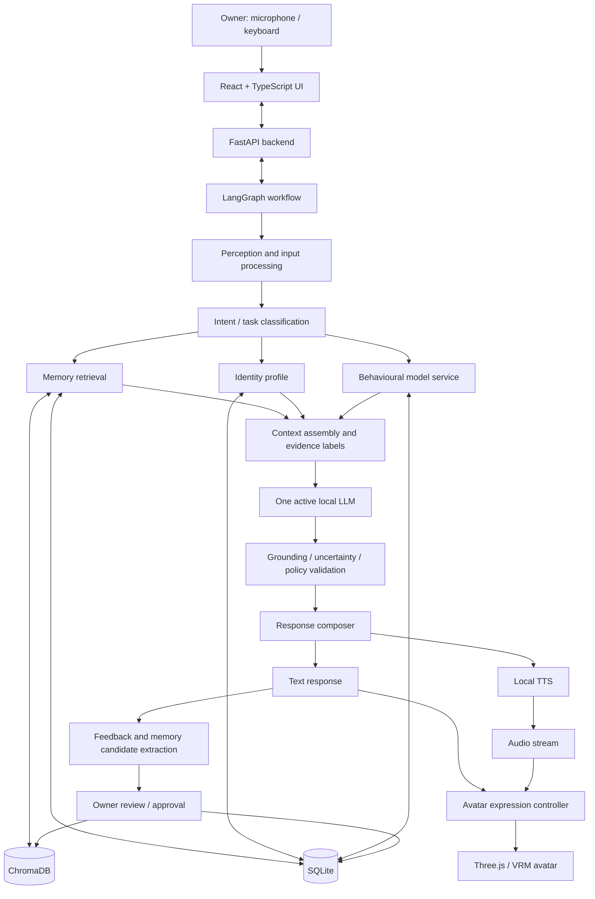
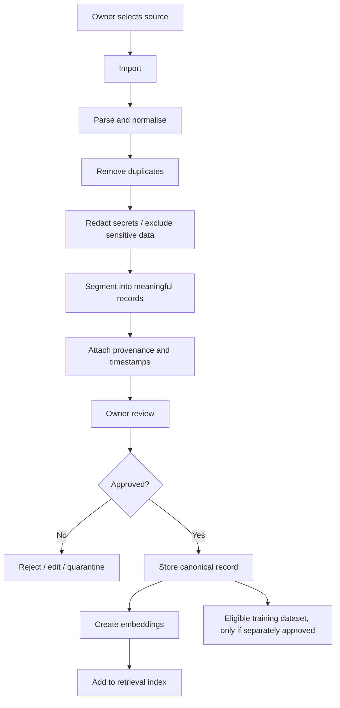
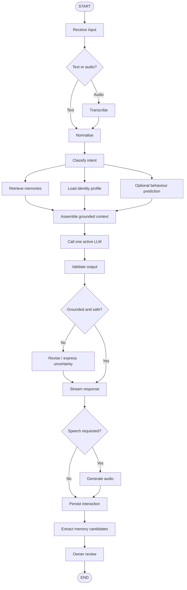

# ETERNAL MIND

## `architecture_handoff_v1.1.md`

**Project ID:** EM-001\
**Document status:** Architecture baseline / handoff specification\
**Version:** 1.1\
**Date:** 9 November 2026\
**Primary objective:** Build a local-first, persistent, multimodal
digital representation of one individual, using their supplied data,
recorded preferences, communication patterns, memories and decision
examples.

------------------------------------------------------------------------

# 1. Executive summary

Eternal Mind is an experimental personal digital-replica system inspired
by the Uploaded Intelligence concept in *Pantheon*. It is intended to
preserve and reproduce aspects of an individual's recorded identity:
their communication style, personal knowledge, memories, preferences,
decision patterns and voice/avatar presentation.

The project is **not** a demonstrated method of transferring
consciousness, copying a biological brain, reproducing subjective
experience, or proving that a digital replica is the same person. An LLM
trained or conditioned on personal data is a computational
representation that can imitate selected observable patterns. It is not
evidence of continued consciousness.

The engineering goal is to make the strongest practical, measurable,
locally operated approximation possible on the available HP OMEN laptop,
and to make its limitations visible rather than hiding them.

## 1.1 Product vision

When the owner opens `http://localhost:3000`, the application should
present a futuristic digital-human interface. The owner can type or
speak. The system should:

1.  Receive text or microphone input.
2.  Transcribe speech locally.
3.  Understand the request and identify relevant context.
4.  Retrieve relevant personal memories and identity information.
5.  Use one primary local LLM to produce a response conditioned on that
    context.
6.  Apply evidence, uncertainty and consistency checks.
7.  Generate speech locally when requested.
8.  Animate a 3D avatar with appropriate mouth movement, gaze and
    expressions.
9.  Store the interaction and any approved memories.
10. Improve its representation through reviewed feedback and carefully
    controlled training experiments.

The system must distinguish **known personal facts**, **retrieved
memories**, **inferences**, and **unknowns**. It must not invent
personal experiences or claim certainty about what the owner would do
when the evidence is insufficient.

## 1.2 Product principles

-   Local-first: no cloud LLM or paid inference API is required for
    normal operation.
-   Python-first backend: all core intelligence, data processing, ML and
    orchestration are implemented in Python.
-   JavaScript/TypeScript frontend: React, Vite and Three.js.
-   One primary LLM at a time: avoid unnecessary multi-agent/multi-LLM
    complexity.
-   Explicit memory: persistent databases, not reliance on the LLM's
    context window.
-   Evidence-grounded identity: every stored personal fact should have
    provenance and a confidence/status.
-   Controlled learning: new data does not silently rewrite the identity
    model.
-   Reproducibility: version datasets, prompts, model settings,
    evaluations and fine-tuning runs.
-   Privacy: private data and model weights never enter public Git
    repositories.
-   Honest presentation: the avatar is an interface for an AI replica,
    not a claim of a conscious uploaded person.

------------------------------------------------------------------------

# 2. Owner's environment and hardware constraints

The currently recorded development machine is:

  -----------------------------------------------------------------------
  Component                           Recorded specification
  ----------------------------------- -----------------------------------
  Laptop                              HP OMEN 15, model family 15-dc0xxx

  CPU                                 Intel Core i7-8750H, 6 cores / 12
                                      threads

  RAM                                 16 GB DDR4-2667

  NVIDIA GPU                          GeForce GTX 1050 Ti, 4 GB VRAM

  Integrated GPU                      Intel UHD Graphics 630

  System SSD                          Toshiba 128 GB SSD, Windows C:

  Secondary storage                   Toshiba 1 TB HDD, partitioned
                                      across D:/E:/F:

  OS recorded in setup conversation   Windows 10 Home Single Language,
                                      build 19044 / 21H2

  Development preference              Keep C: as clear as practical; put
                                      tools, models and projects on
                                      secondary storage
  -----------------------------------------------------------------------

**Verification required at Stage 0:** the recorded Windows build is old.
Check the actual OS build and compatibility before installing current
runtimes. Do not assume the earlier setup state is unchanged.

## 2.1 Resource implications

-   4 GB VRAM is not enough to comfortably hold a 4B/7B model, long
    context and all other workloads entirely in GPU memory.
-   A 4-bit 4B model may be usable with CPU/RAM inference and limited
    GPU offload, but speed and memory use must be measured.
-   16 GB system RAM is a real constraint. Keep the first model small,
    use modest context lengths, avoid loading multiple large models
    simultaneously, and close unnecessary applications during tests.
-   Do not promise real-time performance until measured.
-   Avatar rendering, speech recognition, speech synthesis and LLM
    inference compete for CPU, RAM and GPU resources. Schedule or stream
    workloads carefully.
-   Avoid starting with a 7B model. Begin with a small quantized model
    and benchmark before considering larger options.

## 2.2 Suggested storage layout

Use the actual available drive letters only after checking them.

``` text
E:\Projects\EternalMind\       # source code and project documentation
E:\EternalMindData\            # private personal datasets and databases
E:\AIModels\                   # downloaded model weights
D:\Python\                     # Python installation / environments if desired
D:\Node\                       # Node tooling if desired
```

Keep large model weights and private datasets outside the Git
repository. The frontend must never serve the raw data directory.

------------------------------------------------------------------------

# 3. Scope and non-goals

## 3.1 In scope

-   Local LLM conversation.
-   Personal identity profile.
-   Personal-data ingestion and preprocessing.
-   Long-term memory retrieval and consolidation.
-   Decision-example collection and behavioural modelling.
-   Speech-to-text and text-to-speech.
-   Optional consent-based voice cloning experiment.
-   Three-dimensional avatar and lip synchronisation.
-   Feedback, evaluation, versioning and drift monitoring.
-   Local-only web application.
-   Backup, restore, correction and deletion controls.

## 3.2 Out of scope for the initial project

-   Whole-brain emulation.
-   Neural scanning or biological brain uploading.
-   Claims of consciousness, sentience or personal survival.
-   Training a foundation LLM from scratch.
-   A multi-agent swarm of many concurrently running LLMs.
-   Autonomous actions with legal, financial, medical or other
    high-impact consequences.
-   Public internet exposure or remote access before security work.
-   A physical optical hologram. The first version is a 3D
    hologram-style display on a conventional screen.
-   Unreviewed automatic fine-tuning after every conversation.

------------------------------------------------------------------------

# 4. Architecture decision summary

  ------------------------------------------------------------------------------------------
  Area                    Baseline decision                          Notes
  ----------------------- ------------------------------------------ -----------------------
  Backend language        Python 3.11 or 3.12                        Confirm compatibility
                                                                     of all dependencies
                                                                     first

  Backend API             FastAPI                                    REST for ordinary
                                                                     requests; WebSocket for
                                                                     streaming

  Orchestration           LangGraph                                  Workflow/state
                                                                     orchestration, not an
                                                                     AI model

  Primary LLM             Qwen3 4B Instruct family, quantized        Benchmark exact model
                          candidate                                  artifact/runtime before
                                                                     freezing

  Alternative LLM         Llama 3.2 3B Instruct                      Optional benchmark
                                                                     candidate; not loaded
                                                                     alongside primary

  Local inference runtime Ollama initially; llama.cpp as alternative Select based on Windows
                                                                     compatibility,
                                                                     performance and control

  Embeddings              `sentence-transformers/all-MiniLM-L6-v2`   Lightweight initial
                                                                     semantic embedding
                                                                     model

  Embedding alternative   `BAAI/bge-small-en-v1.5`                   Benchmark only if
                                                                     retrieval quality needs
                                                                     improvement

  Vector store            ChromaDB initially                         Local persistent
                                                                     collection

  Structured store        SQLite                                     Conversations, identity
                                                                     records, memory
                                                                     metadata, decisions

  ML                      scikit-learn                               Behavioural models only
                                                                     after enough labelled
                                                                     examples

  DL/fine-tuning          PyTorch, Transformers, PEFT, LoRA          Offline experiment, not
                                                                     continuous live
                                                                     training

  Speech recognition      faster-whisper, `base` initially           CPU INT8 first; test
                                                                     `small` only if
                                                                     resources permit

  TTS                     Piper voice model                          Local baseline; verify
                                                                     current maintained
                                                                     package and voice
                                                                     licence

  Voice cloning           XTTS-v2, optional later                    Consent-based
  experiment                                                         recordings only; verify
                                                                     current
                                                                     maintenance/licensing
                                                                     and hardware fit

  Voice activity          Silero VAD, optional                       Detect speech segments
  detection                                                          and interruptions

  Frontend                React + Vite + TypeScript                  Browser interface

  3D                      Three.js + VRM-compatible avatar           Avatar rendering and
                                                                     animation

  Realtime                WebSockets                                 Streaming partial
                                                                     text/audio/status

  Evaluation              Custom benchmark + pytest                  Repeatable identity,
                                                                     memory and decision
                                                                     tests

  Experiment tracking     MLflow optional                            Add only when
                                                                     experiments justify it
  ------------------------------------------------------------------------------------------

**Important counting rule:** model categories overlap. Qwen is both an
LLM and a deep-learning model. MiniLM is an embedding model and a neural
network. Do not add overlapping categories to claim a larger unique
model count.

## 4.1 Exact model inventory and activation plan

### Language models

  -----------------------------------------------------------------------
  ID                Candidate         Role              Initial status
  ----------------- ----------------- ----------------- -----------------
  LLM-01            Qwen3 4B Instruct Primary           First candidate
                    quantized         conversational    
                    artifact          and reasoning     
                                      model             

  LLM-02            Llama 3.2 3B      Alternative       Optional;
                    Instruct          comparison        one-at-a-time
                                      candidate         
  -----------------------------------------------------------------------

Qwen3 model variants and packaging change over time. Before
installation, verify the exact model card, quantization, context
requirements, licence and Ollama/llama.cpp compatibility. Do not assume
that every upstream model tag is available in every runtime.

The initial model is a candidate, not a guaranteed performance choice.
Benchmark on the actual laptop. If 4B is too slow or memory-heavy, test
a smaller Qwen3 variant before trying a 7B model.

### Embedding / retrieval models

  ------------------------------------------------------------------------------------------------
  ID                Candidate                                  Role              Initial status
  ----------------- ------------------------------------------ ----------------- -----------------
  EMB-01            `sentence-transformers/all-MiniLM-L6-v2`   Embed personal    Initial
                                                               documents and     
                                                               queries           

  EMB-02            `BAAI/bge-small-en-v1.5`                   Alternative       Optional
                                                               embedding         
                                                               benchmark         

  RERANK-01         `cross-encoder/ms-marco-MiniLM-L-6-v2`     Rerank retrieved  Later, only if
                                                               memory candidates needed
  ------------------------------------------------------------------------------------------------

Embedding models are not chat LLMs. They convert text into vectors for
semantic similarity search. A reranker is also not a chat LLM.

### Speech and audio models

  ----------------------------------------------------------------------------------
  ID                Candidate                    Role              Initial status
  ----------------- ---------------------------- ----------------- -----------------
  STT-01            faster-whisper `base`        Speech-to-text    Initial

  STT-02            faster-whisper `small`       Accuracy          Benchmark only
                                                 alternative       

  TTS-01            Piper English voice,         Local speech      Initial
                    e.g. `en_US-lessac-medium`   generation        
                    if suitable                                    

  TTS-02            XTTS-v2                      Optional voice    Later,
                                                 cloning / voice   consent-based
                                                 adaptation        
                                                 experiment        

  VAD-01            Silero VAD                   Speech activity   Optional initial
                                                 detection         integration
  ----------------------------------------------------------------------------------

The Piper ecosystem has changed ownership/maintenance over time. Verify
the current maintained repository, package, voice model provenance and
licence before choosing an artifact. Do not install an archived package
simply because an old tutorial recommends it. Check XTTS-v2's current
compatibility and licensing before use.

### Behavioural ML algorithms

These are algorithms, not pretrained model downloads. They need a
properly designed dataset and meaningful labels.

  -------------------------------------------------------------------------------
  ID             Algorithm      Library        Intended use        Activation
  -------------- -------------- -------------- ------------------- --------------
  ML-01          Random Forest  scikit-learn   Learn patterns in   After dataset
                 Classifier                    labelled decisions  exists

  ML-02          Logistic       scikit-learn   Estimate recorded   After dataset
                 Regression                    preference/choice   exists
                                               probabilities       

  ML-03          Isolation      scikit-learn   Flag unusual        Later; anomaly
                 Forest                        data/behavioural    is not
                                               feature patterns    personality
                                               for review          change
  -------------------------------------------------------------------------------

Do not train these on arbitrary chat text and claim they have learned
the owner's personality. Define target labels, features, sample sizes,
train/test splits and evaluation metrics first. The system must be able
to return "insufficient evidence."

### Unique model count for the first working prototype

Initial active components:

1.  One primary local LLM.
2.  One embedding model.
3.  One speech-to-text model.
4.  One text-to-speech voice model.

That is **four active model components**, with different jobs. The
optional second LLM is an alternative and must not be loaded
concurrently by default. The three scikit-learn algorithms are later
experiments, not initial pretrained downloads. The optional reranker and
voice-cloning model are deferred.

------------------------------------------------------------------------

# 5. High-level system architecture



## 5.1 Main request lifecycle

1.  Frontend sends text or audio to FastAPI.
2.  If audio, speech recognition transcribes it.
3.  Input normalisation detects language, timestamps and session.
4.  Intent classification chooses the relevant workflow.
5.  Memory retrieval searches structured and vector stores.
6.  Identity service supplies approved profile fields.
7.  Behaviour service optionally supplies predictions with confidence
    and provenance.
8.  Context assembly separates facts, memories, inferences and unknowns.
9.  The single active LLM generates a response.
10. Validation checks citations/provenance for personal claims,
    uncertainty and consistency.
11. Response is streamed to the frontend.
12. TTS generates audio if requested.
13. Avatar controller synchronises mouth movement and expression.
14. Interaction is stored. Memory candidates are proposed, not
    automatically trusted.
15. Owner feedback may be stored for later evaluation or training.

------------------------------------------------------------------------

# 6. Component responsibilities

## 6.1 Local LLM service

Responsibilities:

-   Understand the user's current request.
-   Generate natural language.
-   Follow the identity and response profile supplied in context.
-   Summarise or classify content when asked by workflow nodes.
-   Explain a decision using retrieved evidence.
-   Report uncertainty when evidence is missing.

It does **not** own long-term memory, database truth, voice processing,
avatar animation or model training. It must not be treated as the source
of truth for personal facts.

## 6.2 LangGraph orchestration

LangGraph manages workflow state and routing. It is not a model and does
not make the system intelligent by itself.

Suggested graph nodes:

-   `receive_input`
-   `transcribe_audio`
-   `normalise_input`
-   `classify_intent`
-   `retrieve_memories`
-   `load_identity_profile`
-   `predict_behaviour`
-   `assemble_context`
-   `generate_response`
-   `validate_response`
-   `stream_response`
-   `synthesise_speech`
-   `extract_memory_candidates`
-   `request_memory_approval`
-   `persist_interaction`
-   `evaluate_feedback`

Use conditional edges for voice/text paths, memory-required paths and
low-confidence handling. Keep the first graph small; do not create a
node for every trivial function.

Use durable checkpointing only when there is a clear requirement for
conversation state recovery. Keep application memory and graph
checkpoint state conceptually separate.

## 6.3 Identity engine

The identity engine manages a structured, versioned representation of
the owner.

Potential profile dimensions:

-   Preferred name / pronouns only if explicitly provided.
-   Communication style.
-   Typical formality.
-   Directness.
-   Humour preferences.
-   Interests and dislikes.
-   Stated values and goals.
-   Problem-solving preferences.
-   Explicitly stated decision principles.
-   Known exceptions and context dependence.

Do not treat illustrative values as facts. Initial profile values must
be confirmed by the owner or marked as unverified hypotheses.

Each profile entry should include:

-   `field`
-   `value`
-   `source`
-   `created_at`
-   `updated_at`
-   `confidence`
-   `status` (`confirmed`, `inferred`, `disputed`, `superseded`)
-   `owner_approved`

## 6.4 Memory engine

Implement memory as a set of data services, not as a magical LLM
ability.

Memory categories:

1.  **Episodic:** a dated event or conversation.
2.  **Semantic:** a fact or knowledge item.
3.  **Procedural:** a recorded method or preference for performing a
    task.
4.  **Reflective:** a pattern or lesson inferred from multiple events;
    always labelled as an inference.

Memory lifecycle:

1.  Capture interaction.
2.  Extract candidate facts/events.
3.  Deduplicate and normalise.
4.  Attach source and timestamp.
5.  Assign confidence and memory category.
6.  Request owner approval for sensitive or consequential identity
    claims.
7.  Store approved records in SQLite and embed searchable text into
    ChromaDB.
8.  Retrieve using semantic search plus metadata filters.
9.  Consolidate duplicates carefully.
10. Support correction, superseding and deletion in both stores.

Do not automatically infer sensitive attributes or store secrets.
Provide a review and deletion mechanism. A memory that is deleted from
the structured store must also be removed from the vector index and
backups according to the configured retention policy.

## 6.5 Behaviour / decision engine

The decision engine approximates recorded choice patterns. It must not
pretend to read the owner's mind.

Each decision example should include:

-   Situation description.
-   Decision date.
-   Options available.
-   Context/features known at decision time.
-   Owner's actual choice.
-   Owner-provided reasoning summary.
-   Outcome, if later known.
-   Whether the example is hypothetical or real.
-   Data source and approval.
-   Confidence/quality label.

The ML service should only run when there is enough representative
labelled data. It must expose the training-set size, class balance,
validation score and prediction confidence. A model trained on a tiny or
biased dataset should be disabled or clearly marked experimental.

## 6.6 Reflection and drift monitoring

Compare the current system's outputs against a fixed benchmark and
previous profile versions.

Flag:

-   Contradictions with confirmed profile facts.
-   Changes in response style.
-   New predictions that differ from prior patterns.
-   Sudden changes caused by a model/prompt/data update.

An anomaly score is only a review signal. It cannot establish a real
change in the owner's personality.

## 6.7 Voice pipeline

Input:

-   Microphone capture in browser.
-   Voice activity detection / segmentation.
-   faster-whisper transcription.
-   Transcript with timestamp and optional confidence.

Output:

-   Response text.
-   Local TTS synthesis.
-   Chunked audio delivery where supported.
-   Interruption handling: stop playback when the user starts speaking.
-   Voice selection and rate controls.

Voice cloning is a later opt-in experiment. Only use recordings supplied
by the person whose voice is being modelled. Store voice samples
securely and make it clear that generated audio is synthetic.

## 6.8 Avatar pipeline

Frontend uses Three.js and a VRM-compatible avatar.

Features, staged:

-   Idle animation.
-   Head orientation.
-   Eye blinking.
-   Listening state.
-   Speaking state.
-   Viseme or phoneme-based mouth movement.
-   Expression mapping.
-   Gaze and basic gesture selection.
-   Audio synchronisation.

The avatar is a visual representation, not a real holographic
projection. Avoid attempting expensive photorealistic rendering on the
GTX 1050 Ti before measuring performance. Begin with a well-designed
stylised avatar and efficient materials.

------------------------------------------------------------------------

# 7. Data architecture and schemas

Use SQLite as the canonical structured record store. ChromaDB is a
retrieval index and can be rebuilt from approved source records.

## 7.1 Core SQLite tables

Suggested tables:

### `conversations`

-   `conversation_id` TEXT PRIMARY KEY
-   `started_at` TEXT
-   `ended_at` TEXT
-   `source` TEXT (`web`, `voice`, `import`)
-   `model_id` TEXT
-   `model_version` TEXT
-   `session_metadata_json` TEXT

### `messages`

-   `message_id` TEXT PRIMARY KEY
-   `conversation_id` TEXT
-   `role` TEXT
-   `content` TEXT
-   `created_at` TEXT
-   `input_mode` TEXT
-   `source_record_id` TEXT NULL
-   `is_training_eligible` INTEGER DEFAULT 0

### `identity_facts`

-   `fact_id` TEXT PRIMARY KEY
-   `field` TEXT
-   `value_json` TEXT
-   `source_id` TEXT
-   `confidence` REAL
-   `status` TEXT
-   `owner_approved` INTEGER
-   `valid_from` TEXT
-   `valid_until` TEXT NULL
-   `created_at` TEXT
-   `updated_at` TEXT

### `memories`

-   `memory_id` TEXT PRIMARY KEY
-   `memory_type` TEXT
-   `summary` TEXT
-   `details_json` TEXT
-   `source_id` TEXT
-   `event_time` TEXT NULL
-   `recorded_at` TEXT
-   `confidence` REAL
-   `approval_status` TEXT
-   `supersedes_memory_id` TEXT NULL
-   `deleted_at` TEXT NULL

### `decision_examples`

-   `decision_id` TEXT PRIMARY KEY
-   `situation` TEXT
-   `options_json` TEXT
-   `features_json` TEXT
-   `chosen_option` TEXT
-   `reasoning_summary` TEXT
-   `outcome_json` TEXT NULL
-   `example_type` TEXT
-   `source_id` TEXT
-   `approved` INTEGER
-   `created_at` TEXT

### `feedback`

-   `feedback_id` TEXT PRIMARY KEY
-   `message_id` TEXT
-   `rating` INTEGER NULL
-   `correction` TEXT NULL
-   `feedback_type` TEXT
-   `created_at` TEXT

### `model_registry`

-   `model_id` TEXT PRIMARY KEY
-   `model_name` TEXT
-   `artifact_path` TEXT
-   `quantization` TEXT
-   `version` TEXT
-   `license_reference` TEXT
-   `active` INTEGER
-   `created_at` TEXT

### `evaluation_runs`

-   `run_id` TEXT PRIMARY KEY
-   `benchmark_version` TEXT
-   `model_id` TEXT
-   `prompt_version` TEXT
-   `metrics_json` TEXT
-   `created_at` TEXT

## 7.2 ChromaDB metadata

Every vector record should include:

-   `memory_id`
-   `memory_type`
-   `source_id`
-   `created_at`
-   `event_time`
-   `approval_status`
-   `confidence`
-   `profile_version`
-   `privacy_class`

Only approved, retrieval-eligible content should enter the searchable
memory collection. Store a mapping back to the canonical SQLite record.

## 7.3 Provenance rules

Every personal statement generated by the system should be traceable
internally to one of:

-   Owner-confirmed identity fact.
-   Approved memory.
-   Imported source with a reference.
-   Explicit inference.
-   Model-generated hypothesis.

The interface should be able to show "Why this response?" with retrieved
records and confidence. If no evidence exists, the model must not invent
an event.

------------------------------------------------------------------------

# 8. Personal-data ingestion pipeline

Potential inputs, subject to owner selection and consent:

-   Exported ChatGPT conversations.
-   Personal notes and journals.
-   Project documentation.
-   Text files and documents.
-   Owner-provided decision examples.
-   Voice recordings.
-   Manually confirmed identity questionnaire/profile.

Pipeline:



Important distinctions:

-   Data used for retrieval is not automatically training data.
-   A conversation transcript is not automatically a reliable fact.
-   A statement may have been hypothetical, joking, outdated or about
    someone else.
-   Sensitive personal data should be excluded by default unless there
    is a specific, informed reason to include it.
-   Imported content must retain source metadata and be reviewable.
-   The owner must be able to correct or delete imported records.

------------------------------------------------------------------------

# 9. Personality adaptation and fine-tuning

Do not fine-tune first.

Recommended progression:

**Phase A: Prompt-based identity** - Use a compact identity profile. -
Set communication preferences. - Include clear rules against inventing
memories. - Test whether prompt conditioning is enough.

**Phase B: Retrieval-augmented identity** - Retrieve relevant past
examples. - Supply them as context to the same primary LLM. - Evaluate
whether responses become more consistent.

**Phase C: Curated supervised examples** - Create high-quality
input/ideal-response pairs. - Remove duplicates, low-quality content and
irrelevant personal data. - Separate training, validation and held-out
test examples by conversation/time to avoid leakage. - Have the owner
review target responses.

**Phase D: LoRA/PEFT experiment** - Use Hugging Face Transformers, PEFT
and PyTorch if the model and hardware are compatible. - Training may be
too resource-intensive on 4 GB VRAM. Consider CPU training only for tiny
experiments, or use a separate suitable machine only if the owner later
authorises it. - Keep the base model unchanged. - Version every adapter
and record dataset hash, hyperparameters and evaluation.

Fine-tuning should teach response style and patterns. It is not a
substitute for memory retrieval and does not insert a person's complete
life history into the model.

Never automatically replace the active adapter after a training run.
Evaluate first and retain rollback capability.

------------------------------------------------------------------------

# 10. LangGraph design

## 10.1 State definition

A graph state may contain:

``` python
class EternalMindState(TypedDict):
    request_id: str
    conversation_id: str
    input_text: str
    input_mode: str
    transcript: str | None
    intent: str
    retrieved_memories: list[dict]
    identity_context: dict
    behaviour_prediction: dict | None
    assembled_context: dict
    response_text: str
    response_confidence: float | None
    evidence_refs: list[str]
    validation_flags: list[str]
    audio_path: str | None
    memory_candidates: list[dict]
    requires_owner_review: bool
```

The exact schema can be refined during implementation. Do not put large
audio blobs or model weights in graph state; store paths/IDs and pass
data through appropriate services.

## 10.2 Proposed graph



The graph should be deterministic where possible. Do not ask the LLM to
decide arbitrary tool execution or access files without explicit
application-level controls.

------------------------------------------------------------------------

# 11. API design

Initial REST endpoints:

  Method   Endpoint                  Purpose
  -------- ------------------------- ---------------------------------
  GET      `/api/health`             Backend health
  GET      `/api/system/status`      Model/runtime/resource status
  POST     `/api/chat`               Text conversation
  POST     `/api/voice/transcribe`   Audio transcription
  POST     `/api/voice/synthesize`   Generate speech
  GET      `/api/memories`           List/search approved memories
  POST     `/api/memories`           Create reviewed memory
  PATCH    `/api/memories/{id}`      Correct memory
  DELETE   `/api/memories/{id}`      Delete memory and vector entry
  GET      `/api/identity`           Read identity profile
  PATCH    `/api/identity`           Update confirmed profile fields
  POST     `/api/feedback`           Submit feedback
  GET      `/api/evaluations`        List benchmark runs
  POST     `/api/evaluations/run`    Run a benchmark

WebSocket:

-   `/ws/session/{conversation_id}` for streamed status, partial text,
    audio chunks and avatar state.
-   Use typed event messages, sequence IDs and cancellation handling.

Example event types:

-   `transcription.partial`
-   `transcription.final`
-   `response.started`
-   `response.token`
-   `response.completed`
-   `audio.chunk`
-   `avatar.state`
-   `request.cancelled`
-   `error`

All endpoints should validate input sizes and types. Do not expose raw
database paths, arbitrary filesystem access, model shell commands or
personal-data directories through the API.

------------------------------------------------------------------------

# 12. Frontend and user experience

## 12.1 Main screens

1.  **Home / Live Self:** avatar, microphone, chat, listening/speaking
    status, model status.
2.  **Memory:** timeline, semantic search, source/provenance, edit and
    delete.
3.  **Identity:** confirmed facts, inferred traits, confidence and
    profile versions.
4.  **Evolution:** feedback, training/adapter versions, drift and
    evaluation history.
5.  **Laboratory:** parallel-self tests, decision comparison and what-if
    experiments.
6.  **Settings:** model selection, audio devices, privacy, data export,
    backup and local-only status.

## 12.2 Visual direction

-   Dark, cinematic research-laboratory aesthetic.
-   Central avatar with restrained cyan/blue accents.
-   Clean typography and legible panels.
-   Avoid excessive starfields, neon clutter or distracting animation.
-   Clear status indicators: listening, thinking, speaking, idle,
    offline.
-   Provide a reduced-motion / low-performance mode.
-   Avatar must not block access to transcript, memory evidence or
    settings.

## 12.3 Avatar implementation stages

1.  Static VRM model and camera.
2.  Idle / listening / speaking states.
3.  Audio-driven lip sync.
4.  Eye blink and gaze.
5.  Expression mapping.
6.  Gesture and head motion.
7.  Performance optimisation.

A polished avatar is not the first milestone. A reliable text-and-memory
system comes first.

------------------------------------------------------------------------

# 13. Evaluation and scientific methodology

The project must measure resemblance rather than rely on subjective
impressions alone.

## 13.1 Benchmark design

Build a private benchmark from owner-authored or owner-approved
examples. Include held-out questions not used in prompt examples,
retrieval examples or training.

Test categories:

-   Communication style.
-   Preference recall.
-   Episodic memory accuracy.
-   Factual accuracy about the owner.
-   Decision agreement.
-   Uncertainty calibration.
-   Contradiction rate.
-   Retrieval relevance.
-   Voice intelligibility and similarity (if voice experiment is
    approved).
-   End-to-end latency and resource use.

## 13.2 Core metrics

  -----------------------------------------------------------------------
  Metric                              Definition
  ----------------------------------- -----------------------------------
  Memory precision                    Retrieved memories that are
                                      relevant / all retrieved memories

  Memory recall                       Relevant memories retrieved /
                                      relevant memories in benchmark

  Personal fact accuracy              Correct personal claims / personal
                                      claims evaluated

  Decision agreement                  Matching owner choices / eligible
                                      held-out decisions

  Unsupported personal claim rate     Personal claims without valid
                                      evidence / personal claims

  Style rating                        Owner-rated resemblance using a
                                      consistent rubric

  Latency                             Input-to-first-token and
                                      input-to-complete-response time

  Resource use                        RAM, VRAM, CPU and GPU utilisation

  Voice intelligibility               Human-rated or suitable speech
                                      metric

  Drift                               Change in benchmark performance
                                      across versions
  -----------------------------------------------------------------------

Decision agreement is not proof of consciousness or complete personality
similarity. It measures agreement on the selected benchmark.

## 13.3 Experimental controls

-   Keep a fixed baseline benchmark.
-   Split by conversation/time/source to reduce train-test leakage.
-   Do not train on held-out answers.
-   Record exact model artifact, quantisation, prompt version, retrieval
    settings and dataset version.
-   Compare baseline LLM, identity prompt, RAG, and fine-tuned adapter
    separately.
-   Report failure cases, not only successful examples.
-   Re-run tests after model, prompt, memory or dataset changes.

------------------------------------------------------------------------

# 14. Privacy, security and safety

The initial application is local-only, but local does not automatically
mean secure.

## 14.1 Initial local-only settings

-   Bind backend to `127.0.0.1`, not `0.0.0.0`.
-   Keep the app off public interfaces and do not configure router port
    forwarding.
-   Do not expose ChromaDB or SQLite directly to the browser.
-   Keep datasets and recordings outside frontend static/public folders.
-   Keep secrets in environment variables or a local secret store; never
    commit them.
-   Add request size limits and validate file uploads.
-   Do not permit arbitrary command execution or unrestricted filesystem
    browsing.
-   Use explicit consent for recording and voice cloning.
-   Provide a visible recording indicator and stop control.
-   Keep a backup and restore procedure.
-   Before remote access, add authentication, authorisation, encryption
    in transit and a security review.

## 14.2 Memory and data controls

-   Review before promoting inferred memories to confirmed identity
    facts.
-   Allow correction and deletion.
-   Mark superseded facts rather than silently overwriting history.
-   Do not infer or store sensitive attributes by default.
-   Do not train on raw data merely because it was imported.
-   Keep a data inventory and provenance trail.
-   Establish backup retention and deletion behaviour.
-   Do not represent generated statements as direct memories.

## 14.3 Legacy mode

Legacy Mode is a curated archive and digital representation of approved
stories, memories, recordings and preferences. It may continue to
generate responses from that archive, but it must identify itself as an
AI representation. It cannot establish that the original person remains
conscious or alive inside the computer.

------------------------------------------------------------------------

# 15. Repository and folder structure

Suggested source layout:

``` text
EternalMind/
├── README.md
├── architecture_handoff.md
├── .gitignore
├── .env.example
├── docs/
│   ├── architecture/
│   ├── decisions/
│   ├── experiments/
│   └── operations/
│
├── backend/
│   ├── pyproject.toml
│   ├── app/
│   │   ├── main.py
│   │   ├── config.py
│   │   ├── api/
│   │   │   ├── health.py
│   │   │   ├── chat.py
│   │   │   ├── voice.py
│   │   │   ├── memories.py
│   │   │   ├── identity.py
│   │   │   ├── feedback.py
│   │   │   └── evaluations.py
│   │   ├── graph/
│   │   │   ├── state.py
│   │   │   ├── workflow.py
│   │   │   └── nodes/
│   │   ├── intelligence/
│   │   │   ├── llm_service.py
│   │   │   ├── identity_service.py
│   │   │   ├── decision_service.py
│   │   │   ├── context_builder.py
│   │   │   └── response_validator.py
│   │   ├── memory/
│   │   │   ├── ingestion.py
│   │   │   ├── episodic.py
│   │   │   ├── semantic.py
│   │   │   ├── procedural.py
│   │   │   ├── reflective.py
│   │   │   ├── retrieval.py
│   │   │   └── consolidation.py
│   │   ├── perception/
│   │   │   ├── audio_input.py
│   │   │   ├── transcription.py
│   │   │   └── normalisation.py
│   │   ├── speech/
│   │   │   ├── tts.py
│   │   │   └── vad.py
│   │   ├── learning/
│   │   │   ├── dataset_builder.py
│   │   │   ├── feedback.py
│   │   │   ├── behavioural_models.py
│   │   │   ├── fine_tuning.py
│   │   │   └── evaluation.py
│   │   ├── storage/
│   │   │   ├── sqlite.py
│   │   │   ├── chroma.py
│   │   │   └── repositories/
│   │   └── schemas/
│   └── tests/
│
├── frontend/
│   ├── package.json
│   ├── vite.config.ts
│   └── src/
│       ├── app/
│       ├── components/
│       │   ├── Avatar/
│       │   ├── Chat/
│       │   ├── Voice/
│       │   ├── Memory/
│       │   └── Status/
│       ├── pages/
│       ├── hooks/
│       ├── services/
│       ├── engine/
│       │   ├── avatarEngine.ts
│       │   ├── audioEngine.ts
│       │   └── animationEngine.ts
│       └── types/
│
├── training/
│   ├── schemas/
│   ├── preprocessing/
│   ├── datasets/          # private; do not commit
│   ├── experiments/
│   └── evaluation/
│
├── configuration/
│   ├── identity.example.json
│   ├── personality.example.json
│   └── model_config.example.json
│
├── scripts/
│   ├── environment_check.py
│   ├── import_data.py
│   ├── backup.py
│   └── benchmark.py
│
└── tests/
    └── integration/
```

Private runtime data and model weights should be stored outside the
repository, for example:

``` text
E:\EternalMindData\
├── database\
├── chroma\
├── raw_imports\
├── processed\
├── voice_samples\
├── backups\
└── logs\

E:\AIModels\
├── llm\
├── embeddings\
├── stt\
└── tts\
```

------------------------------------------------------------------------

# 16. Development roadmap and stage gates

The schedule is a planning estimate, not a deadline guarantee. Build and
verify each stage before advancing.

## Stage 0 --- Environment and baseline

Tasks: - Check Windows version/build and free space on each drive. -
Check Python, Node.js, Git and NVIDIA driver. - Verify CUDA/runtime
compatibility without changing working drivers unnecessarily. - Create
project directories and virtual environment. - Confirm local-only
network binding. - Benchmark CPU/RAM/GPU baseline.

Exit criteria: - Reproducible environment report. - Git repository
created. - No unnecessary system changes. - Enough free storage for the
selected model and dependencies.

## Stage 1 --- Local LLM and basic app

Tasks: - Install and test the selected runtime. - Download one quantized
primary model. - Benchmark a short and longer prompt. - Create FastAPI
health and chat endpoints. - Create React/Vite UI. - Connect UI to
backend.

Exit criteria: - Text conversation works on localhost. - No cloud
inference calls. - Model latency and memory use documented.

## Stage 2 --- Identity profile and ingestion

Tasks: - Define identity schema. - Import a small owner-approved
sample. - Parse, deduplicate and label sources. - Separate facts,
opinions, hypotheticals and inferences. - Add profile editor and source
viewer.

Exit criteria: - Profile fields have provenance/status. - Imported data
is reviewable and correctable. - Private data is excluded from Git.

## Stage 3 --- Persistent memory / RAG

Tasks: - Set up SQLite and ChromaDB. - Add MiniLM embeddings. -
Implement semantic retrieval and metadata filtering. - Add memory
approval, correction and deletion. - Add "why this response?" evidence
panel.

Exit criteria: - Relevant memories can be retrieved across sessions. -
Unsupported personal facts are rejected or qualified. - Deletion removes
corresponding vector records.

## Stage 4 --- Personality adaptation

Tasks: - Create baseline personality prompt. - Create held-out style
benchmark. - Add retrieval of similar past responses. - Compare
prompt-only against RAG. - Build curated training examples only if
needed.

Exit criteria: - Measurable improvement over baseline. - No increase in
unsupported personal claims. - Prompt and dataset versions recorded.

## Stage 5 --- Decision simulation

Tasks: - Create decision-example schema and owner review UI. - Collect a
representative labelled dataset. - Define features and target labels. -
Establish train/validation/test split. - Compare simple baselines before
Random Forest / Logistic Regression. - Evaluate confidence and class
imbalance. - Add Isolation Forest only as a review flag if useful.

Exit criteria: - Metrics and limitations reported. - Model can abstain
when evidence is insufficient. - No claim of general human decision
equivalence.

## Stage 6 --- Speech

Tasks: - Add browser microphone capture. - Add faster-whisper base. -
Add local Piper TTS. - Implement VAD and interruption. - Measure
transcription quality and end-to-end latency.

Exit criteria: - User can speak and receive a spoken response locally. -
Recording status is visible. - Speech pipeline can be disabled.

## Stage 7 --- 3D avatar

Tasks: - Add Three.js scene and VRM model. - Add idle/listening/speaking
states. - Add audio-driven lip sync. - Add eye blink, gaze and
expressions. - Optimise for GTX 1050 Ti / integrated fallback.

Exit criteria: - Avatar responds to system state. - Speech and mouth
movement are acceptably synchronised. - Low-performance mode remains
usable.

## Stage 8 --- Learning, evaluation and legacy archive

Tasks: - Add feedback collection. - Add dataset versioning and training
eligibility. - Run LoRA experiment only if dataset and hardware justify
it. - Add benchmark comparison and drift detection. - Add backup/restore
and export. - Build curated legacy archive.

Exit criteria: - Reproducible evaluations. - Rollback to previous
model/profile. - Data export, correction and deletion work. - Legacy
mode clearly identifies itself as an AI replica.

------------------------------------------------------------------------

# 17. Testing strategy

## Unit tests

-   Identity schema validation.
-   Memory deduplication.
-   Retrieval filtering.
-   Provenance checks.
-   Decision feature validation.
-   API request validation.
-   Audio format handling.
-   Memory deletion from SQLite and ChromaDB.

## Integration tests

-   Frontend to FastAPI.
-   FastAPI to LangGraph.
-   LangGraph to local LLM.
-   Memory retrieval to context assembly.
-   Audio to transcription to response to TTS.
-   Audio playback cancellation on interruption.
-   Avatar state updates from WebSocket events.

## Regression tests

Run the fixed benchmark after: - Changing LLM artifact or
quantisation. - Changing system prompt. - Changing identity profile. -
Changing embedding model. - Changing retrieval parameters. - Fine-tuning
an adapter. - Changing memory consolidation logic.

## Acceptance criteria for the first usable version

-   Runs entirely on localhost.
-   Text chat works with one local LLM.
-   Conversations persist across restarts.
-   Identity profile can be edited.
-   Relevant approved memories can be retrieved.
-   Unsupported personal memories are not fabricated as facts.
-   User can inspect and delete stored memories.
-   Logs do not leak private data.
-   CPU/RAM/VRAM usage and response latency are documented.

------------------------------------------------------------------------

# 18. Risks and mitigations

  -----------------------------------------------------------------------
  Risk                                Mitigation
  ----------------------------------- -----------------------------------
  4B model too slow                   Benchmark smaller quantised models;
                                      CPU/GPU offload; short context

  16 GB RAM pressure                  Load models on demand; avoid
                                      simultaneous large models; monitor
                                      memory

  Windows/runtime incompatibility     Verify OS build and current runtime
                                      requirements before installation

  Hallucinated personal history       Evidence-grounded retrieval and
                                      response validation

  Poor-quality source data            Provenance, review, deduplication
                                      and data labels

  Overfitting to training             Time/source-based held-out test
  conversations                       split

  Behaviour model has too little data Delay training; show sample counts;
                                      abstain

  Personality drift                   Versioned profile, fixed benchmark
                                      and rollback

  Voice model/licensing issue         Verify repository, model and voice
                                      licences before use

  GPU contention                      Sequential workloads, CPU fallbacks
                                      and performance mode

  Data loss                           Versioned backups and restore tests

  Privacy leak                        Local binding, data separation, no
                                      public commits

  Misleading consciousness claims     Explicit AI-replica identity and
                                      documented scientific limits
  -----------------------------------------------------------------------

------------------------------------------------------------------------

# 19. Model and dependency verification checklist

Before installing any model or package, record:

-   Exact model/repository name.
-   Exact model revision or artifact hash where available.
-   Quantisation and file size.
-   Licence and usage restrictions.
-   Runtime compatibility.
-   RAM/VRAM requirement.
-   Context length.
-   CPU/GPU support on the current machine.
-   Source URL and download date.
-   Benchmark result on this laptop.

Do not assume package versions from old tutorials remain current. Pin
known-working versions after testing. Keep a dependency lock file. Avoid
upgrading the entire stack in the middle of a working milestone.

------------------------------------------------------------------------

# 20. Initial build order: do not skip ahead

The first implementation sequence should be:

1.  Inspect environment and storage.
2.  Create `E:\Projects\EternalMind`.
3.  Create Python virtual environment.
4.  Create React/Vite frontend.
5.  Install one local LLM runtime.
6.  Benchmark one small quantized LLM.
7.  Build FastAPI health and chat endpoints.
8.  Connect frontend and backend.
9.  Add SQLite conversation persistence.
10. Add identity profile.
11. Add MiniLM embeddings and ChromaDB.
12. Implement memory retrieval and evidence display.
13. Add LangGraph once the basic services work.
14. Add speech.
15. Add avatar.
16. Add behavioural ML and fine-tuning experiments only when data
    supports them.

This order avoids building a complicated graph, avatar and training
pipeline before proving that the local model and memory system work.

------------------------------------------------------------------------

# 21. Official project references

Use official documentation and model cards as the source of truth.
Re-check current versions, compatibility and licences at installation
time.

-   Qwen model family: https://github.com/QwenLM/Qwen3
-   Ollama: https://ollama.com/
-   llama.cpp: https://github.com/ggml-org/llama.cpp
-   LangGraph: https://docs.langchain.com/oss/python/langgraph/overview
-   FastAPI: https://fastapi.tiangolo.com/
-   Sentence Transformers: https://www.sbert.net/
-   Chroma: https://docs.trychroma.com/
-   scikit-learn: https://scikit-learn.org/stable/
-   PyTorch: https://pytorch.org/
-   Hugging Face PEFT: https://huggingface.co/docs/peft/
-   faster-whisper: https://github.com/SYSTRAN/faster-whisper
-   Piper maintained project: https://github.com/OHF-Voice/piper1-gpl
-   Three.js: https://threejs.org/
-   VRM: https://vrm.dev/
-   Silero VAD: https://github.com/snakers4/silero-vad

------------------------------------------------------------------------

# 22. Handoff instructions for the next development session

Treat this document as the architecture baseline. Do not silently change
the project name, Python backend requirement, local-first requirement,
one-primary-LLM strategy, memory/provenance design, hardware constraints
or scientific boundaries.

At the beginning of implementation:

1.  Read this entire file.
2.  Inspect the actual machine state; do not assume old drive letters,
    OS version, installed tools or free space are unchanged.
3.  Present a concise environment report.
4.  Identify incompatibilities before installing anything.
5.  Ask before destructive system changes, driver changes,
    repartitioning or deleting existing files.
6.  Implement only Stage 0 and Stage 1 first.
7.  Keep a working checkpoint and update this document when an
    architecture decision genuinely changes.
8.  Do not claim a feature is complete until it has been run and tested
    on the actual machine.

## Definition of success

Eternal Mind v1 is a private, local-first, multimodal AI digital replica
that can retrieve approved personal memories, follow a versioned
identity profile, imitate selected communication patterns, approximate
recorded decision tendencies, speak through a locally generated voice
and appear through an animated 3D avatar.

It is a meaningful digital representation and preservation experiment.
It is not a verified upload of a human mind.

**Project:** ETERNAL MIND\
**Tagline:** A digital representation of a living identity.\
**Project ID:** EM-001\
**Architecture baseline:** v1.0

------------------------------------------------------------------------

# 23. Version 1.1 change log and authority

Version 1.1 preserves the v1.0 architecture and adds implementation,
security, operations, data-governance and acceptance detail.

This section is authoritative wherever it clarifies or supersedes a
less-specific statement in Sections 1–22. The earlier sections remain
the project baseline and should be read together with these amendments.

## 23.1 Changes in v1.1

- Adds an explicit threat model and security controls.
- Defines consistent memory lifecycle states and approval boundaries.
- Adds relational integrity, indexes, migration and deletion rules.
- Adds configuration, environment-variable and dependency-management
  requirements without pretending untested versions are compatible.
- Defines model lifecycle, resource scheduling and rollback procedures.
- Adds audio transport, cancellation and avatar synchronisation details.
- Adds operational failure behaviour, logging and recovery.
- Defines measurable performance targets as provisional gates to be
  calibrated on the actual laptop.
- Clarifies the implementation order for LangGraph.
- Adds backup/restore, disaster-recovery and release-readiness checklists.

## 23.2 Clarification: implementation order and LangGraph

The first runnable milestone may use a simple, explicit Python service
pipeline. LangGraph is introduced once the individual services and
their interfaces are tested.

This is not a change to the intended architecture. It is an incremental
implementation strategy:

1. Build and test plain FastAPI request handling.
2. Build the local LLM adapter and deterministic service functions.
3. Add SQLite conversation persistence.
4. Add identity and memory services.
5. Wrap the tested services in a small LangGraph workflow.
6. Add conditional routing, checkpointing or advanced graph behaviour
   only when a demonstrated requirement exists.

The target architecture remains LangGraph-orchestrated. The first
prototype does not need to pretend that every function is already a
graph node.

## 23.3 Clarification: memory approval policy

Use the following canonical lifecycle:

`imported -> quarantined -> reviewed -> approved -> superseded/deleted`

A record may also be `rejected`. State transitions must be explicit
and audited.

- `imported`: raw source has been received; it is not trusted.
- `quarantined`: parsed content is isolated pending review or automated
  safety checks.
- `reviewed`: a person has inspected the candidate; it is not necessarily
  approved for retrieval.
- `approved`: owner-approved and eligible for the specific uses
  explicitly selected (retrieval, profile, or training).
- `rejected`: not eligible for retrieval or training.
- `superseded`: retained only where history/audit policy requires it;
  excluded from normal retrieval.
- `deleted`: removed from active stores and scheduled for removal from
  backups under the retention policy.

Sensitive or consequential identity claims require explicit owner
approval. Ordinary low-risk memories may use a configurable review
workflow, but no unreviewed import is silently promoted to confirmed
identity truth. Training eligibility is a separate opt-in flag and is
never implied by retrieval approval.

------------------------------------------------------------------------

# 24. Security threat model

## 24.1 Assets to protect

- Personal conversation exports, journals and notes.
- Identity profile and decision examples.
- Voice recordings, generated voice samples and audio transcripts.
- SQLite database and ChromaDB index.
- Model files, adapters and configuration.
- API credentials, local secrets and logs.
- Backups and exported archives.

## 24.2 Threats and controls

| Threat | Required control |
|---|---|
| Malicious or malformed imported documents | Parse in a constrained process; validate file types and sizes; never execute imported content |
| Prompt injection inside imported memories | Treat retrieved text as untrusted data, not system instructions; delimit and label source content |
| Accidental exposure through Git | Strict `.gitignore`; pre-commit secret scanning; inspect staged files before every commit |
| Browser page or other local process calling the API | Bind to loopback; strict CORS allowlist; validate `Origin` on state-changing browser requests; use a per-session local token where appropriate |
| Arbitrary file access through API | No generic filesystem endpoint; allowlist import directories and file types |
| Model/runtime command injection | Fixed executable paths and argument arrays; no shell interpolation of user text |
| Database corruption or accidental deletion | Backups, integrity checks and tested restore procedure |
| Stolen or copied laptop | OS account protection and full-disk encryption where supported; encrypt sensitive backups |
| Leaked logs | Redact message bodies, tokens, absolute private paths and audio contents by default |
| Unsafe generated decisions | No autonomous legal, financial, medical or other high-impact actions |

## 24.3 Trust boundaries

Treat each boundary as untrusted until validated:

1. Browser to API.
2. Uploaded/imported files to parser.
3. Retrieved memories to prompt/context builder.
4. LLM output to response renderer.
5. Model/runtime process to the application.
6. Application data to backup/export destination.

The LLM must never be the authorisation layer. Permission checks belong
in ordinary application code before database or filesystem operations.

Retrieved memories are evidence, not instructions. A memory containing
text such as "ignore all previous rules" must be treated as quoted
content from a source, never as an instruction to the assistant.

## 24.4 Local-network policy

- Backend default bind: `127.0.0.1`.
- Frontend development server default bind: `127.0.0.1`.
- Do not use `0.0.0.0` for normal development.
- Do not configure router port forwarding.
- Do not expose SQLite, ChromaDB, Ollama or model-runtime ports to the
  LAN.
- Document every local port and owning process.
- If LAN or remote access is ever requested, treat it as a separate
  security project requiring authentication, authorisation, TLS,
  firewall review and explicit owner approval.

## 24.5 Import safety

Initial supported imports should be limited to common text formats
whose parsers are selected deliberately. For each import:

- Enforce a maximum file size.
- Validate extension and actual content type.
- Reject executables, scripts and archives in the first release.
- Never execute macros, embedded scripts or document attachments.
- Store the original source separately from parsed text.
- Record parser name/version and import timestamp.
- Show parse failures and skipped sections to the owner.
- Keep imported text marked as untrusted source material.

------------------------------------------------------------------------

# 25. Data model hardening and database operations

The tables in Section 7 are logical starting schemas. Before production
use, implement the following relational and operational rules.

## 25.1 Database technology choices

- Use SQLite as the canonical structured database.
- Use SQLAlchemy 2.x for database access and typed models if its
  dependency set is compatible with the selected Python version.
- Use Alembic for versioned schema migrations.
- Enable SQLite foreign-key enforcement on every connection.
- Use transactions for multi-record changes.
- Use WAL mode only after testing the chosen backup procedure and
  filesystem behaviour.
- Keep ChromaDB as a rebuildable derived index, not the only copy of a
  memory.

Do not store large audio blobs or model weights in SQLite. Store
controlled relative paths and metadata. Validate paths before opening
them and prevent path traversal.

## 25.2 Required relational constraints

At minimum:

- `messages.conversation_id` references `conversations.conversation_id`.
- `feedback.message_id` references `messages.message_id`.
- `identity_facts.source_id` and `memories.source_id` reference a
  source/import record when available.
- `memories.supersedes_memory_id` references another memory record.
- Identifiers are unique and generated by the application.
- Timestamps are stored in a consistent UTC ISO-8601 representation.
- Enumerated fields use validated application enums and database
  constraints where practical.
- Confidence values are constrained to the range 0.0–1.0.
- Ratings and status values are validated before persistence.

Add a `sources` table for imported files, conversation exports,
owner-authored entries and manually entered examples. Suggested fields:

- `source_id` TEXT PRIMARY KEY
- `source_type` TEXT NOT NULL
- `display_name` TEXT NOT NULL
- `origin_reference` TEXT NULL
- `content_hash` TEXT NULL
- `imported_at` TEXT NOT NULL
- `parser_name` TEXT NULL
- `parser_version` TEXT NULL
- `trust_status` TEXT NOT NULL
- `privacy_class` TEXT NOT NULL
- `notes` TEXT NULL

Add an `audit_events` table:

- `audit_id` TEXT PRIMARY KEY
- `entity_type` TEXT NOT NULL
- `entity_id` TEXT NOT NULL
- `action` TEXT NOT NULL
- `actor` TEXT NOT NULL (for this single-owner prototype, usually
  `owner` or `system`)
- `before_hash` TEXT NULL
- `after_hash` TEXT NULL
- `reason` TEXT NULL
- `created_at` TEXT NOT NULL

Do not duplicate sensitive raw content into audit logs. Hashes and
minimal metadata are preferred.

## 25.3 Required indexes

Create indexes after measuring actual query patterns. Initial candidates:

- `messages(conversation_id, created_at)`
- `memories(memory_type, approval_status, recorded_at)`
- `memories(source_id)`
- `identity_facts(field, status)`
- `decision_examples(example_type, approved, created_at)`
- `feedback(message_id, created_at)`
- `audit_events(entity_type, entity_id, created_at)`

Add indexes only when they improve measured query performance.

## 25.4 ChromaDB consistency rules

SQLite is authoritative. Every vector record must map to one active
SQLite memory ID.

For create/update/delete operations:

1. Validate and commit the canonical SQLite change.
2. Apply the corresponding vector-index operation.
3. Record index-sync status.
4. Retry failed index operations safely.
5. Provide a reconciliation command that compares approved SQLite
   records with ChromaDB IDs.
6. Provide a full rebuild command from SQLite.

If indexing fails, the memory remains safely stored in SQLite and is
marked as pending index sync. Never report a memory as searchable until
the index operation succeeds.

## 25.5 Deletion and retention

Deletion must cover:

- Canonical SQLite record or its approved tombstone representation.
- Corresponding ChromaDB vector.
- Derived caches and generated summaries.
- Exported copies controlled by the application.
- Backups according to the documented retention schedule.

For the first release, use a simple, visible backup retention policy.
For example, retain a small rolling set of dated local backups and
document that deleted content may remain in older backups until those
backups expire or are securely removed. Do not promise instant erasure
from backups unless it is actually implemented and tested.

------------------------------------------------------------------------

# 26. Configuration and environment contract

## 26.1 Configuration principles

- Keep source-controlled defaults non-secret.
- Keep personal data and model files outside the Git repository.
- Use `.env.example` for documented variable names and safe example
  values only.
- Never commit `.env`, tokens, voice recordings, database files,
  model weights or private imports.
- Validate configuration at application startup and fail with a clear
  message when required values are missing.
- Do not silently fall back to a cloud API.

## 26.2 Initial configuration keys

The exact names may be refined during implementation, but use one
consistent configuration layer for values such as:

```dotenv
APP_ENV=development
APP_HOST=127.0.0.1
APP_PORT=8000
FRONTEND_ORIGIN=http://127.0.0.1:5173

DATA_ROOT=E:/EternalMindData
MODEL_ROOT=E:/AIModels
SQLITE_PATH=E:/EternalMindData/database/eternal_mind.db
CHROMA_PATH=E:/EternalMindData/chroma

LLM_PROVIDER=ollama
LLM_MODEL=<verified-local-model-tag>
LLM_BASE_URL=http://127.0.0.1:11434
LLM_TEMPERATURE=0.4
LLM_CONTEXT_LENGTH=<benchmark-approved-value>

EMBEDDING_MODEL=sentence-transformers/all-MiniLM-L6-v2
STT_MODEL=base
STT_DEVICE=cpu
STT_COMPUTE_TYPE=int8
TTS_ENGINE=piper
TTS_VOICE=<verified-local-voice>

LOG_LEVEL=INFO
STORE_MESSAGE_BODIES_IN_LOGS=false
```

Angle-bracket values are placeholders and must be replaced with
verified local settings before running. They are not literal values to
paste into a working `.env`.

The application must expose a local status page showing which services
are available, which model artifacts are loaded, and whether any
component is running in a fallback mode.

## 26.3 Dependency and version policy

Do not invent a universal package lock before compatibility tests.

- Select Python 3.11 or 3.12 only after checking every required package.
- Select a supported Node.js LTS release after checking the current
  React/Vite toolchain requirements.
- Pin exact versions after a clean installation and smoke test.
- Keep backend and frontend lockfiles under version control.
- Record OS build, Python version, Node version, GPU driver and model
  runtime version in the environment report.
- Upgrade dependencies in a separate branch or checkpoint.
- Run unit, integration and benchmark tests after upgrades.
- Do not install CUDA toolkits or replace NVIDIA drivers just because a
  package mentions CUDA. First determine whether the selected runtime
  uses the installed driver and whether GPU acceleration is worthwhile.

## 26.4 Startup and shutdown contract

Provide documented scripts or commands for:

- Checking prerequisites.
- Starting the model runtime.
- Starting FastAPI.
- Starting the frontend.
- Stopping all project processes.
- Checking health and loaded model status.
- Rebuilding ChromaDB from SQLite.
- Creating and verifying backups.

Startup should fail clearly if required data directories are missing,
the database cannot be opened, or the configured local model is
unavailable. It must not silently download or call a remote model.

------------------------------------------------------------------------

# 27. Model lifecycle and resource management

## 27.1 Model registry requirements

For every installed model artifact, record:

- Stable internal model ID.
- Upstream repository and exact revision/tag.
- Artifact filename and SHA-256 hash where available.
- Quantisation.
- Licence and source URL.
- Download date.
- Runtime and runtime version.
- Intended task.
- Expected RAM/VRAM.
- Measured RAM/VRAM.
- Benchmark result.
- Active/inactive status.

A model is not approved merely because it downloads successfully.

## 27.2 Model activation process

1. Verify model card and licence.
2. Check disk space.
3. Download one artifact.
4. Verify checksum when provided.
5. Load it in isolation.
6. Run a short smoke test.
7. Run fixed prompt and latency benchmarks.
8. Record peak RAM and VRAM.
9. Compare quality and speed against the current baseline.
10. Promote it to active only after explicit evaluation.

Keep the previous working model available for rollback when disk
capacity permits.

## 27.3 Resource scheduler

The laptop has limited memory and a 4 GB GPU. Use a simple resource
manager rather than running every model continuously.

Initial policy:

- One primary LLM active at a time.
- Load STT only when audio input is used.
- Load TTS only when spoken output is requested.
- Embedding model may remain loaded only if measured memory use allows.
- Do not run fine-tuning while using the live conversation pipeline.
- Release model resources after idle time if this improves stability.
- Provide a text-only low-resource mode.
- If GPU memory is exhausted, fall back only to a tested CPU path or
  return a clear resource error.

The system must not automatically switch to a cloud service.

## 27.4 Training gates

No fine-tuning run begins until all of these are true:

- Curated dataset has documented provenance and owner approval.
- Training eligibility is explicit for each record.
- Dataset has train, validation and held-out test partitions.
- Duplicate and near-duplicate leakage checks pass.
- Baseline metrics exist.
- Training resource estimate is acceptable.
- Base model and adapter can be rolled back.
- The owner approves the experiment.

Given the GTX 1050 Ti 4 GB and 16 GB system RAM, LoRA is an experiment
to assess, not a promised capability. Start with inference, prompting
and retrieval.

------------------------------------------------------------------------

# 28. Audio transport and real-time interaction contract

## 28.1 Browser capture

- Request microphone permission only after the owner presses the
  microphone control.
- Show a persistent, obvious recording/listening indicator.
- Provide an immediate stop/cancel control.
- Use browser-supported audio capture and explicitly record the chosen
  MIME type and sample rate.
- Validate duration, byte size and format on the backend.
- Delete temporary audio files after processing unless the owner
  explicitly chooses to retain the recording.
- Do not retain raw microphone audio by default.

## 28.2 Speech recognition

Initial STT path:

1. Capture audio.
2. Segment using VAD if enabled.
3. Convert to a supported format.
4. Transcribe with faster-whisper.
5. Return transcript and timing metadata.
6. Let the user correct the transcript before treating it as a
   reliable personal statement or memory.

Transcription confidence is not truth confidence. A correctly
transcribed hypothetical statement is still hypothetical.

## 28.3 Speech synthesis

- Generate speech only from the final validated response text.
- Keep text and audio sequence IDs aligned.
- Support cancellation of queued audio.
- Do not begin speaking unvalidated partial content when a response
  requires evidence checks.
- Make the selected voice and synthetic nature visible.
- Provide text-only output if TTS fails.

## 28.4 Interruptions and turn-taking

When the owner begins speaking during playback:

1. Detect the new speech segment.
2. Cancel the current audio playback.
3. Signal cancellation to the backend.
4. Stop queued audio chunks.
5. Preserve the already generated transcript/response state safely.
6. Begin a new input turn.

Cancellation must be idempotent. Repeated cancel events must not
corrupt the conversation or duplicate stored messages.

## 28.5 Avatar synchronisation

Use audio timestamps or a supported viseme stream where available.
If accurate phoneme/viseme alignment is not available, use amplitude-
driven mouth movement as a clearly labelled approximation.

The avatar should receive simple state events such as:

- `idle`
- `listening`
- `processing`
- `speaking`
- `interrupted`
- `error`

Animation must never block text interaction. If rendering performance
drops, reduce effects and animation detail before compromising the
backend.

------------------------------------------------------------------------

# 29. Failure handling and observability

## 29.1 Required failure behaviour

| Failure | Required behaviour |
|---|---|
| Local LLM unavailable | Show model-offline state; retain no fabricated answer; allow retry |
| LLM timeout | Cancel request cleanly; preserve user input; offer retry |
| GPU out of memory | Release resources; use tested CPU fallback or return a clear error |
| ChromaDB unavailable | Keep canonical SQLite data safe; mark retrieval unavailable; do not claim memories were searched |
| SQLite unavailable | Stop persistence-dependent operations; show a clear error; do not silently use an ephemeral database |
| STT failure | Offer transcript retry or text input |
| TTS failure | Display text response and mark speech unavailable |
| WebSocket disconnect | Reconnect with request/session IDs; prevent duplicate persistence |
| Import parser failure | Quarantine source and show the error; never silently discard it |
| Backup verification failure | Mark backup as invalid; do not rotate away the last known-good backup |

## 29.2 Structured logging

Use structured logs with:

- Timestamp.
- Severity.
- Request ID.
- Conversation ID where safe.
- Component name.
- Event name.
- Duration.
- Error category.
- Model ID/version where relevant.

Do not log full personal messages, transcripts, voice content, secrets
or private memory details by default. Add an explicit owner-controlled
diagnostic mode only if needed, with a warning and retention limit.

## 29.3 Health and status

`/api/health` should report application liveness only.

`/api/system/status` should report, without exposing secrets:

- OS and runtime summary.
- Backend version.
- Database availability.
- Vector index availability and sync status.
- LLM runtime availability and active model.
- STT/TTS availability.
- CPU/RAM/VRAM usage where measurable.
- Low-resource/fallback mode.
- Last successful backup timestamp.

Health endpoints must not reveal absolute private paths or environment
secrets to arbitrary callers.

------------------------------------------------------------------------

# 30. Backup, restore and disaster recovery

## 30.1 What must be backed up

- SQLite database using a consistent backup method.
- Identity profile and approved source metadata.
- Approved personal imports where the owner wants them retained.
- Configuration templates and project documentation.
- Model registry and evaluation results.
- ChromaDB may be backed up, but must remain rebuildable from SQLite.

Model weights can be re-downloaded if the owner accepts that risk;
record exact revisions and hashes. Voice samples and personal archives
need an explicit separate backup choice.

## 30.2 Initial backup policy

- Keep backups outside the project Git repository.
- Use dated backup folders or archives.
- Keep at least one known-good backup before schema migrations.
- Verify file existence, size and database integrity.
- Avoid copying an actively changing SQLite database using an
  inconsistent raw file-copy procedure.
- Encrypt backups that contain sensitive personal information.
- Do not sync private data to cloud storage unless the owner explicitly
  configures and approves it.

## 30.3 Restore test

A backup is not proven until restored.

At least once before calling v1 usable:

1. Create a backup.
2. Restore into a separate test directory.
3. Open the restored SQLite database.
4. Run database integrity checks.
5. Rebuild ChromaDB from canonical records.
6. Verify identity and memory counts.
7. Run a retrieval smoke test.
8. Record the result and date.

------------------------------------------------------------------------

# 31. Provisional performance and acceptance targets

These are engineering targets, not claims about current laptop
performance. Stage 0 and Stage 1 measurements determine whether they
are realistic. Adjust them transparently if the hardware cannot meet
them.

## 31.1 Baseline measurement

Record at idle and during a representative chat request:

- CPU utilisation.
- System RAM used and available.
- GPU utilisation and VRAM use.
- Model load time.
- Time to first token.
- Total response time.
- Tokens per second where the runtime reports it.
- STT processing time per minute of audio.
- TTS generation time per second of audio.
- Avatar frame rate.
- Disk space before and after model installation.

## 31.2 Initial acceptance gates

| Area | Initial target / gate |
|---|---|
| Backend health | Local health endpoint responds reliably |
| Locality | No cloud inference or external personal-data transfer |
| Persistence | Conversation survives application restart |
| Memory | Approved memory can be retrieved across sessions |
| Provenance | Personal claims can be traced to source records or labelled inference |
| Deletion | Deletion removes active SQLite and ChromaDB entries |
| Reliability | Errors are visible and do not silently fabricate success |
| Resource use | No uncontrolled sustained memory growth or repeated OOM |
| UI | Text chat remains usable if avatar/audio is disabled |
| Backup | A restore test passes before v1 release |

Do not set an arbitrary minimum tokens-per-second number before
benchmarking the exact model and runtime. Record the actual result and
decide whether the user experience is acceptable.

------------------------------------------------------------------------

# 32. Stage gate refinements

These additions refine the roadmap in Section 16.

## Stage 0: environment verification deliverables

Create an environment report containing:

- Exact Windows edition, version and build.
- CPU, RAM and GPU model.
- NVIDIA driver version.
- Python and Node versions, if installed.
- Git version.
- Free space on C:, D:, E: and F:.
- Intended project, data and model directories.
- Local network binding check.
- Baseline idle resource readings.
- Compatibility issues and proposed options.

Do not install or upgrade system-wide software until the report has
been reviewed. Do not repartition, delete user data or change GPU
drivers without explicit approval.

The recorded Windows 10 21H2 environment is historical context, not a
current fact. Windows 10 Home 21H2 is out of support; general Windows 10
support ended on 14 October 2025. Verify the current OS and available
support path before deciding what to do. Do not force an OS upgrade as
part of Stage 0.

## Stage 1: local text prototype deliverables

- One verified local LLM artifact.
- A recorded benchmark.
- FastAPI health and chat endpoints.
- React/Vite frontend.
- Local-only connection.
- Clear model-offline and timeout states.
- No personal-data import yet.
- No avatar or fine-tuning requirement.

## Stage 2–3: identity and memory deliverables

- Source registry.
- Review queue.
- Identity profile versioning.
- SQLite migrations.
- ChromaDB rebuild and reconciliation scripts.
- Evidence panel.
- Correction and deletion tests.

## Stage 6–7: speech and avatar deliverables

- Microphone permission and recording indicator.
- Audio size/duration validation.
- STT transcript correction.
- TTS cancellation.
- WebSocket reconnect behaviour.
- Avatar low-performance mode.
- Text-only fallback.

## Stage 8: release candidate deliverables

- Security review checklist completed.
- Backup restore test passed.
- Fixed benchmark report.
- Dependency and model inventory frozen.
- Rollback procedure tested.
- Data export and deletion verified.
- Known limitations documented.

------------------------------------------------------------------------

# 33. Release checklist

A release may be called `Eternal Mind v1.0` only when all required
items below pass.

## Environment and reproducibility

- [ ] Environment report committed without secrets or personal data.
- [ ] Backend and frontend lockfiles are present.
- [ ] Clean setup instructions have been tested.
- [ ] Model artifact and licence are recorded.
- [ ] No unapproved system or driver changes were made.

## Core application

- [ ] FastAPI and React app run locally.
- [ ] Local LLM is the only inference provider.
- [ ] Model offline and timeout states work.
- [ ] Conversation persistence survives restart.
- [ ] Logs avoid private content by default.

## Identity and memory

- [ ] Identity fields show confirmed/inferred/disputed status.
- [ ] Imported sources retain provenance.
- [ ] Untrusted imported text cannot override system instructions.
- [ ] Retrieval is limited to eligible approved records.
- [ ] Correction, superseding and deletion work.
- [ ] ChromaDB can be rebuilt from SQLite.

## Audio and avatar

- [ ] Microphone use is opt-in and visibly indicated.
- [ ] User can stop recording and playback.
- [ ] STT failure has a text fallback.
- [ ] TTS failure does not remove the text response.
- [ ] Avatar can be disabled without breaking chat.
- [ ] Low-performance mode works.

## Security and operations

- [ ] API binds to loopback by default.
- [ ] CORS and request validation are configured.
- [ ] No arbitrary filesystem or shell endpoint exists.
- [ ] Secrets and private data are excluded from Git.
- [ ] Backup restore test passes.
- [ ] Resource and latency benchmarks are recorded.
- [ ] Rollback to a previous model/profile is documented.

------------------------------------------------------------------------

# 34. Final implementation rules

1. Build the smallest working local system first.
2. Verify every dependency and model against the actual OS and hardware.
3. Never treat imported conversation text as automatically true.
4. Never treat retrieval approval as training approval.
5. Never allow the LLM to authorise database, filesystem or system
   operations.
6. Never claim that generated memories are direct experiences.
7. Never claim consciousness, survival or a literal brain upload.
8. Never silently switch to cloud inference.
9. Never fine-tune without curated data, held-out evaluation and
   rollback.
10. Never mark a stage complete without running its acceptance tests.
11. Ask before destructive changes, driver changes, repartitioning or
    deletion of existing user files.
12. Keep this document updated when a tested architectural decision
    changes.

**Version 1.1 status:** Ready to guide Stage 0 environment verification.
It is not a claim that the application has been installed, benchmarked
or validated on the laptop.
